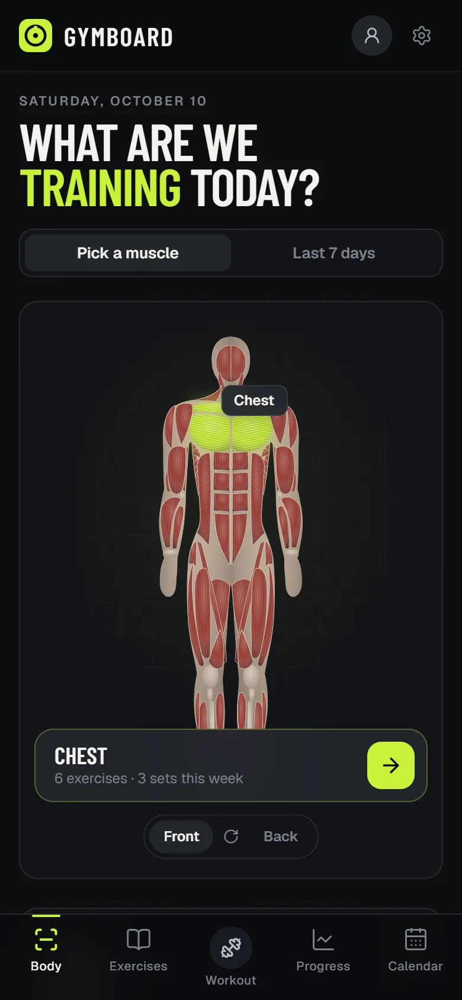
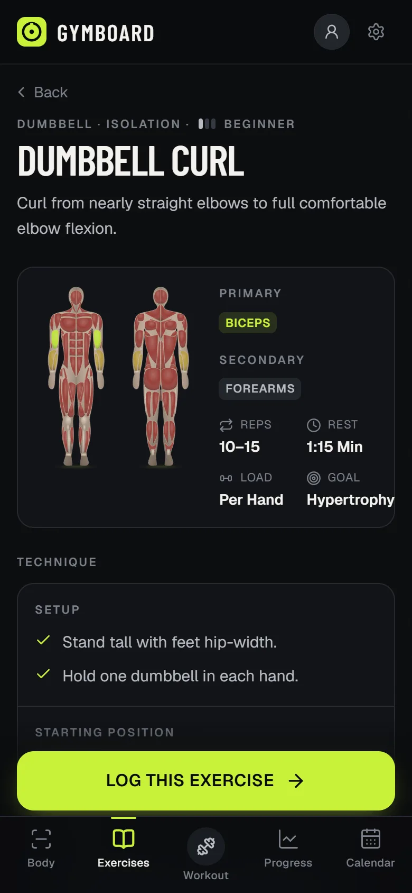
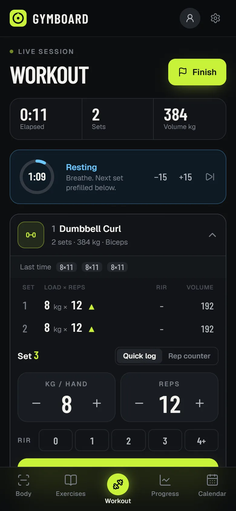
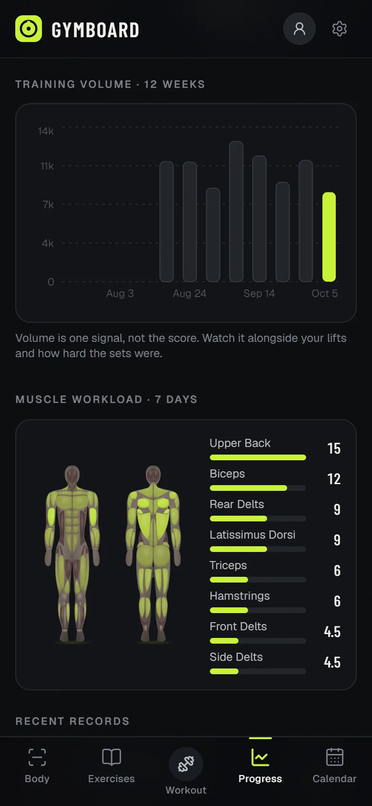
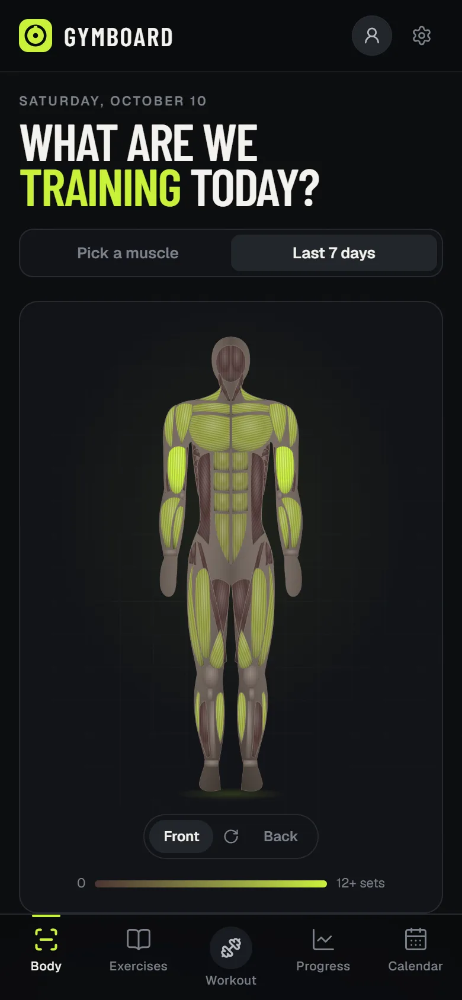
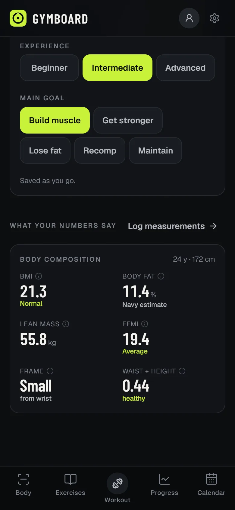
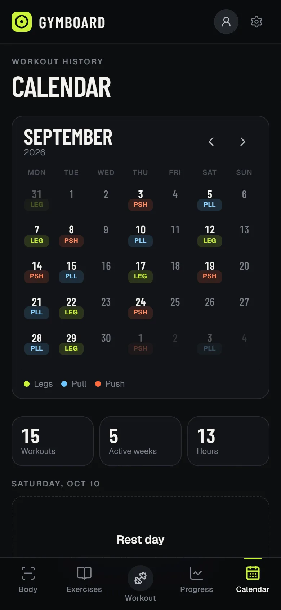

<p align="center">
  
</p>

<h1 align="center">Gymboard</h1>

<p align="center">
  <b>Pick a muscle. Learn the lift. Log the work. See the progress.</b><br />
  A mobile-first gym tracker that works offline, right on your phone.
</p>

<p align="center">
  <a href="https://gym.shiverion.com"><b>→ Open Gymboard at gym.shiverion.com</b></a>
</p>

---

## Screenshots

<table>
  <tr>
    <td align="center" width="25%"><br /><sub><b>Pick a muscle</b></sub></td>
    <td align="center" width="25%"><br /><sub><b>Learn the lift</b></sub></td>
    <td align="center" width="25%"><br /><sub><b>Log the work</b></sub></td>
    <td align="center" width="25%"><br /><sub><b>See the progress</b></sub></td>
  </tr>
  <tr>
    <td align="center"><br /><sub><b>What you've trained this week</b></sub></td>
    <td align="center"><br /><sub><b>Body composition</b></sub></td>
    <td align="center"><br /><sub><b>Training calendar</b></sub></td>
    <td></td>
  </tr>
</table>

<sub>Screenshots use sample data.</sub>

## What it does

Gymboard follows one flow: **Body → Muscle → Exercise → Technique → Workout → Progress.**

- **Interactive anatomy map.** Tap a muscle on the front or back of the body to see exercises that train it. Switch to *Last 7 days* to see which muscles you've actually worked.
- **Exercise library with technique guides.** 60 movements with setup, execution, tempo, breathing, common mistakes and safety cues.
- **Fast workout logging.** Weight, reps and RIR per set, a tap-per-rep counter, a rest timer, and your last session shown as you go.
- **Progressive overload.** Each lift is compared with your previous session, and the app suggests targets for next time.
- **Personal records.** Heaviest set, rep PRs, best volume and estimated 1RM are detected automatically.
- **Progress & history.** Weekly volume, muscle workload, per-lift strength charts and a workout calendar.
- **Body tracking.** Bodyweight trend plus 12 tape measurements. From your profile it works out BMI, estimated body fat (US Navy method), lean mass, FFMI and frame size. Progress photos stay on your device.

## System Design

The source code is private; this is a high-level view of how Gymboard is built.

### Requirements

- **Offline-first**: logging a set must never depend on the gym's network.
- **Cross-device**: sign in on another device and the history is there.
- **Private by default**: only the account owner can read their data; progress photos stay on the device.
- **Installable**: works like a native app without an app store.

### Architecture

```text
 Phone (installable web app)
   UI ─► local data layer ─► on-device database (IndexedDB)  ◄─ service worker (offline shell)
                    │
                    │  background sync queue (retries when back online)
                    ▼
   Google sign-in ─► cloud database, one private space per user (owner-only access rules)
```

### Key Decisions

| Decision | Why | Trade-off |
| --- | --- | --- |
| Save locally first, sync later | Instant logging and full offline use | Two copies of the data must be reconciled |
| Newest change wins when syncing | Simple, predictable merges | Simultaneous edits on two devices keep only the newer one |
| No custom backend | Near-zero running cost, nothing to operate | Access control relies entirely on database rules |
| Exercise library bundled with the app | Technique guides work offline | New exercises ship with app updates |

### Next Steps as It Grows

- Faster incremental sync for long training histories.
- Optional encrypted backup for progress photos.

## Use it on your phone

Gymboard is a web app you can install like a regular app — nothing to download from a store.

1. Open **[gym.shiverion.com](https://gym.shiverion.com)** on your phone.
2. Sign in with Google.
3. Add it to your home screen:
   - **iPhone (Safari):** Share → *Add to Home Screen*
   - **Android (Chrome):** ⋮ menu → *Install app* / *Add to Home screen*

## Works offline

Gym Wi-Fi is unreliable, so every set is saved on your phone the moment you log it. When you're back online, your history syncs to your account automatically. Sign in on another device and it's all there.

## Privacy

- Your training data is tied to your Google account and only you can read it.
- Progress photos never leave your device.
- No ads, no social feed, no selling data.

---

<sub>Gymboard is a personal project by <a href="https://shiverion.com">Muhammad Iqbal Hilmy Izzulhaq</a>. The source code is private; this repository is its public home page. Questions or feedback: open an issue.</sub>
